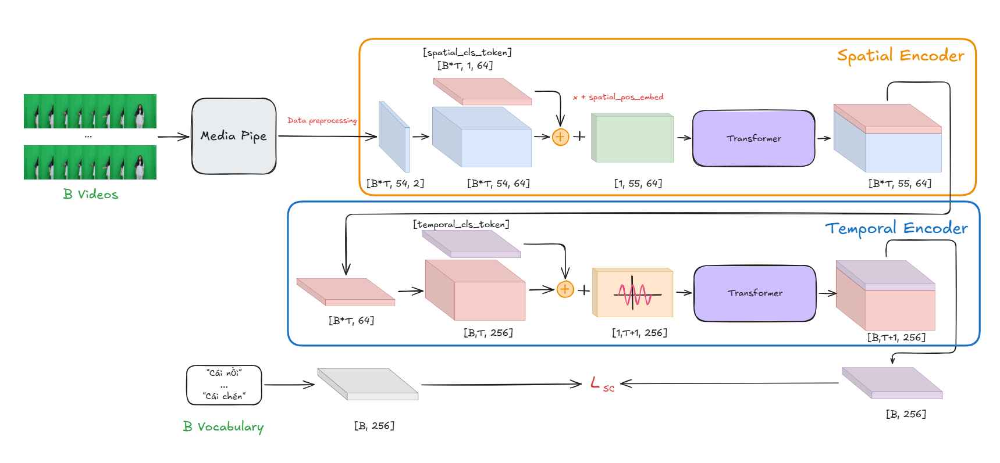
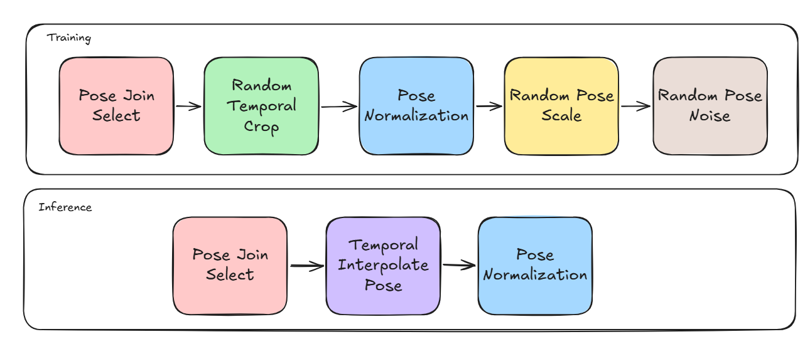

<div align="center">
  <h1>VSLNet — Vietnamese Sign Language Recognition</h1>
  <p>
    
    
    
    
    
    
    
    
  </p>
</div>

> **VSLNet** is a **Vietnamese Sign Language (VSL)** recognition system built from video sequences, combining PyTorch deep learning with a real-time web interface. Instead of classifying individual frames, the project extracts **54 body & hand keypoints** via MediaPipe, encodes them with a **dual-stage Transformer (spatial + temporal)**, and maps them into a shared embedding space with **400 gloss vocabulary entries** through contrastive learning.

---

## ✨ Key Features

- 🧠 **VSLContrastiveNet Architecture** — A model combining `VideoEncoder` (2-layer spatial Transformer + 2-layer temporal Transformer with Positional Encoding) and `TextEncoder` (Embedding + MLP). Both branches are L2-normalized and matched via a learnable `logit_scale` similarity matrix (CLIP-style).

- 🦴 **Pose Extraction from Video** — The `prepare` pipeline uses the `video_to_pose` tool (MediaPipe format) to convert `.mp4/.avi/.mov/.mkv` videos into `.pose` files, while automatically cleaning corrupted `.pose` files before processing.

- 🔧 **Smart Pose Preprocessing** — The `data_preprocessing` module selects 12 body landmarks + 42 hand landmarks, normalizes body/hand scale, applies random temporal cropping (train), interpolates to 64 frames (val/test/inference), and adds noise and random scaling for data augmentation.

- 📊 **End-to-End Training** — The `train` CLI uses AdamW, 5-epoch warmup + CosineAnnealingLR, `SupervisedContrastiveLoss`, tracks R@1/R@5/R@10/MeanRank (V2T & T2V), logs to TensorBoard, saves `best.pth` and `lasted.pth`, and exports `val_confidence_analysis.csv`.

- 🧪 **Evaluation & Confidence Analysis** — The `test` CLI loads `checkpoint/best.pth`, measures bidirectional retrieval metrics, and exports `test_confidence_analysis.csv` with average confidence for correct/incorrect predictions.

- 🌐 **Real-Time Inference API** — FastAPI endpoint `POST /predict` accepts `.webm` video, converts via FFmpeg, extracts pose, runs the `best_v1.pth` model, and returns `{ action, confidence }` from a 400-entry Vietnamese gloss dictionary.

- 📹 **Interactive Web Demo** — The React app (`demo/`) supports 3 modes: **Live Camera**, **Screen Capture** (draggable crop area via `react-rnd`), and **Video Upload**. Automatically detects motion (frame diff), records video segments on silence, sends to the API, and displays a **Live Transcript** when confidence > 80%.

- 👥 **Signer-Based Dataset Splitting** — `VSLPoseDataset` splits train/val/test by `signer_id` (e.g., val `007, 020`; test `024, 015`; shared val/test `009`), supporting multiple camera views: `front_view`, `left_view`, `right_view`.

---

## 🛠 Tech Stack

| Category | Technology | Role in the Project |
|---|---|---|
| **Machine Learning** | PyTorch, TorchVision | Training & inference of VSLContrastiveNet |
| **Computer Vision** | MediaPipe, OpenCV, pose-format | Extraction & reading of 54-point skeleton data |
| **Backend API** | FastAPI, Uvicorn | Serves `/predict` endpoint on port `8000` |
| **Frontend** | React 19, Vite 8 | Real-time demo interface |
| **UI / Styling** | Tailwind CSS, react-rnd | Dark mode layout, draggable crop region |
| **HTTP Client** | Axios | Sends video blobs from browser to API |
| **Data** | Pandas, NumPy, PyYAML | Gloss management, JSON metadata, YAML config |
| **Training Monitoring** | TensorBoard, tqdm, Matplotlib, Seaborn | Metric logging, progress bars, analysis |
| **System Tools** | FFmpeg, `video_to_pose` (CLI) | Video conversion & pose extraction for inference/prepare |
| **GPU (optional)** | CUDA / NVIDIA drivers | Accelerates training & inference |

> **Note:** This project **does not use a database** (SQL/NoSQL). All data is stored as `.pose`, `.csv`, `.json` files and `.pth` checkpoints.

---

## 📁 Project Architecture

```
VSLNet/
├── config/
│   └── vsl_net_configuration.yaml   # GPU, paths, hyperparameters
├── models/
│   ├── vsl_net.py                   # VSLContrastiveNet — main model
│   ├── video_encoder.py             # Spatial + temporal Transformer
│   ├── text_encoder.py              # Encodes gloss ID → embedding
│   └── metrics.py                   # SupervisedContrastiveLoss & retrieval metrics
├── dataset/
│   ├── vsl_dataset.py               # PyTorch Dataset, train/val/test split
│   ├── data_preprocessing.py        # Pose transforms: crop, normalize, augment
│   ├── prepare_dataset.py           # CLI prepare — video → .pose
│   ├── analytics.ipynb              # Data analysis notebook
│   └── root/                        # Root data directory
│       ├── gloss.csv                # 400 VSL vocabulary entries (id, gloss)
│       ├── front_view.json          # Video metadata (per camera view)
│       ├── left_view.json
│       ├── right_view.json
│       └── {view}/*.pose              # Extracted pose files (gitignored)
├── mode/
│   ├── trainer.py                   # Training loop
│   ├── tester.py                    # Test set evaluation
│   └── inferencer.py                # FastAPI inference server
├── checkpoint/                      # Stores best.pth, lasted.pth, analysis CSVs
├── demo/                            # React + Vite frontend
│   ├── src/App.jsx                  # Camera / screen / upload UI
│   ├── package.json
│   └── vite.config.js
├── run.py                           # CLI entry point (train/test/inference/prepare)
├── requirements.txt                 # Python dependencies
└── LICENSE                          # Apache License 2.0
```

---

## 🚀 Getting Started

### System Requirements

- **Python** ≥ 3.10
- **Node.js** ≥ 18 (for frontend)
- **FFmpeg** — available in `PATH`
- **`video_to_pose`** — CLI from `pose-format` / `simple-video-utils`, available in `PATH`
- **NVIDIA GPU + CUDA** (recommended for training)

### 1. Clone the repository

```bash
git clone https://github.com/<your-org>/VSLNet.git
cd VSLNet
```

### 2. Set up the Python environment

```bash
python -m venv .venv

# Windows (PowerShell)
.\.venv\Scripts\Activate.ps1

# macOS / Linux
source .venv/bin/activate

pip install -r requirements.txt
```

### 3. Prepare the dataset

Place videos in subdirectories under `dataset/root/` (e.g., `front_view/`, `left_view/`, `right_view/`) along with the corresponding JSON metadata files.

```bash
python run.py prepare --path config/vsl_net_configuration.yaml
```

> This command cleans corrupted `.pose` files and extracts keypoints from all videos.

### 4. Train the model

```bash
python run.py train --path config/vsl_net_configuration.yaml
```

Optionally override hyperparameters via CLI:

```bash
python run.py train --epochs 300 --batch-size 128 --lr 1e-4 --gpu 0
```

Monitor with TensorBoard:

```bash
tensorboard --logdir ./tensorboard
```

### 5. Evaluate on the test set

```bash
python run.py test --path config/vsl_net_configuration.yaml
```

### 6. Run real-time inference (Backend API)

Ensure `checkpoint/best_v1.pth` exists (production weights for inference).

```bash
python run.py inference --path config/vsl_net_configuration.yaml
```

The API runs at **`http://127.0.0.1:8001`** by default (`VSLNET_PORT` overrides the port), main endpoint: `POST /predict`. This separate port avoids conflicting with Signify's alphabet recognition service.

The response retains `action`, `confidence`, and `processing_ms`, and also includes
`timings` (`upload_read_ms`, `ffmpeg_ms`, `pose_extraction_ms`,
`preprocessing_ms`, `model_inference_ms`, `python_total_ms`). Durations use a
monotonic clock. `VSLNET_MAX_CONCURRENT_INFERENCE` defaults to `1`; excess
requests receive HTTP 429. `VSLNET_POSE_MODE=cli` is the default preprocessing
path. `VSLNET_POSE_MODE=inprocess` is experimental and reuses the same
`pose_video` library function inside the API process. Keep `cli` for real VSL
use until the tensor and prediction comparison passes on representative VSL
videos. The in-process path currently has no hard pose-extraction timeout.

To measure technical latency against a running API without claiming VSL
accuracy, run `python scripts/benchmark_api.py --synthetic --runs 4`. Use
`--video path/to/real-vsl.webm` for a representative clip. Run regression tests
with `python -m unittest discover -s tests -v` after activating the Python
environment and adding FFmpeg to `PATH`.

### 7. Run the Demo UI (Frontend)

Open a new terminal:

```bash
cd demo
npm install
npm run dev
```

Visit **`http://localhost:5173`** — make sure the backend API is running before using the recognition modes.

### 8. Production build (optional)

```bash
cd demo
npm run build
npm run preview
```

---

## ⚙️ Configuration

This project **does not use `.env` files**. All configuration lives in `config/vsl_net_configuration.yaml` and can be overridden via CLI arguments.

| Config Key | Description | Default Value |
|---|---|---|
| `GPU` | List of GPU IDs to use | `[0]` |
| `DATA_PATH` | Path to the data directory | `./dataset/root` |
| `CHECKPOINT` | Directory for model & analysis CSVs | `./checkpoint` |
| `VOCAB_SIZE` | Number of gloss entries in the dictionary | `400` |
| `EMBEDDING_SIZE` | Embedding vector dimension | `256` |
| `FRAMES` | Number of pose frames per sample | `64` |
| `EPOCHS` | Number of training epochs | `300` |
| `BATCH_SIZE` | Batch size | `128` |
| `LR` | Learning rate (AdamW) | `1e-4` |
| `RESUME` | Resume from `lasted.pth` | `False` |
| `TENSORBOARD` | TensorBoard log directory | `./tensorboard` |
| `WORKERS` | Number of workers for dataset preparation | `15` |
| `OVERWRITE` | Overwrite existing `.pose` files | `False` |
| `PRODUCTION` | Production inference mode flag | `True` |

**Supported CLI arguments:**

| Command | Example |
|---|---|
| `train` | `python run.py train --epochs 100 --batch-size 64 --resume True` |
| `test` | `python run.py test --data ./dataset/root` |
| `inference` | `python run.py inference --frames 64` |
| `prepare` | `python run.py prepare --overwrite True --workers 8` |

---

## 🔄 How It Works

For the inference-only Docker image and GitHub Actions → Dokploy setup, see
[README-DEPLOY.md](README-DEPLOY.md). The deployed service binds port 8001
inside the container; local `run.py inference` still defaults to loopback.

### Signify experimental binary streaming

`/ws/vsl/stream` is an experimental alternative to clip-based `/predict`. It
uses the already loaded `best_v1.pth` and a MediaPipe Holistic tracker per
session. The model still classifies an isolated 64-step pose window into one
gloss; it does not translate continuous sign language or sentences. The
rolling-window stability rule is a heuristic and has not been validated on
annotated Vietnamese signing video. Keep `VSL_WORDS` clip mode available as
the fallback.

Spring Boot issues a five-minute session token after checking the active call
and signer. Python verifies the token and asks Spring Boot whether the session
is still active. Python authenticates its prediction callback with a separate
service secret. Both services must receive the same
`SIGNIFY_VSL_STREAMING_SECRET` environment variable (at least 32 UTF-8 bytes).
Streaming is disabled when it is unset. Do not put this value in frontend
configuration. Set `VSLNET_BACKEND_URL` for the callback target and
`VSLNET_ALLOWED_ORIGINS` to a comma-separated list of exact browser origins.
Set `SIGNIFY_VSL_WS_URL` on Spring Boot to the WebSocket URL reachable by the
signer's browser; local `127.0.0.1` only works when that browser runs on the
same machine. Use `wss://` when the frontend is served over HTTPS.

In PowerShell, generate a local secret once and supply its value to the two
service terminals through your normal secret manager or local environment:

```powershell
[Convert]::ToBase64String([Security.Cryptography.RandomNumberGenerator]::GetBytes(48))
```

With the existing Python 3.11 `.venv` and checkpoint:

```powershell
cd 'D:\BuiGiaHuy\CN8\EXE202\model\VLSNet\VSLNet'
$env:VSLNET_BACKEND_URL = 'http://127.0.0.1:8080'
$env:VSLNET_ALLOWED_ORIGINS = 'http://localhost:3000'
.\.venv\Scripts\python.exe run.py inference
```

The frontend starts the stream from its existing WebRTC camera. Its binary
message has a 17-byte big-endian header: version (1 byte), sequence number
(4), capture timestamp in Unix milliseconds (8), and JPEG length (4), followed
by the JPEG bytes. The Java service receives only prediction metadata, not
images. `VSL_PARTIAL` is temporary and is never added to the gloss transcript;
only `VSL_FINAL` is eligible. The in-memory Java session registry currently
supports one backend instance and must be redesigned before horizontal scale.

### Architecture
<div align="center">
  
</div>

### Pose Preprocessing
<div align="center">
  
</div>

---

## 🤝 Contributing

Contributions are welcome! To get involved:

1. **Fork** the repository to your account.
2. Create a new branch: `git checkout -b feature/your-feature-name`.
3. Commit your changes: `git commit -m "feat: short description"`.
4. Push to remote: `git push origin feature/your-feature-name`.
5. Open a **Pull Request** describing your changes and test results.

> **Tip:** When adding new gloss entries, update `gloss.csv`, the JSON metadata files, and adjust `VOCAB_SIZE` in the config file accordingly.

---

## 📄 License

This project is released under the **[Apache License 2.0](LICENSE)**.

You are free to use, modify, and distribute the source code under the terms in the `LICENSE` file, provided you retain the copyright notice and license terms.

---

<blockquote>
<strong>VSLNet</strong> aims to build a technology bridge between the deaf community and hearing people in Vietnam — turning sign language gestures into readable text, in real time.
</blockquote>
